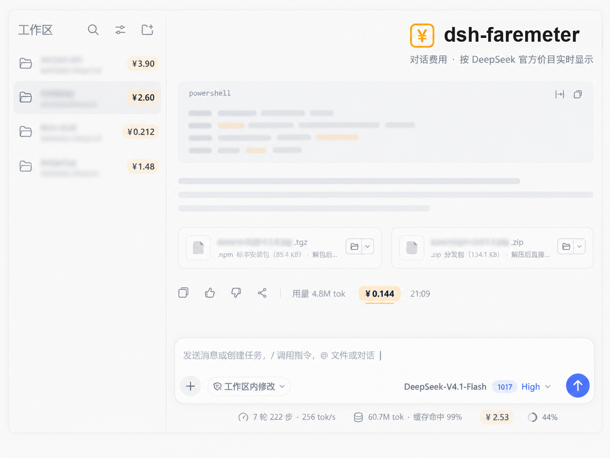

<div align="center">

# dsh-faremeter — 给 AI 对话打表

token 按官方三档 + 峰谷实时计价；2026-11-01 起网页搜索/抓取按次计费（¥5/1000 次），一次不漏。每轮 · 每会话 · 每工作区，三处人民币金额。

**简体中文** · [English](README_en.md)




</div>

三个显示位置：

| 位置 | 显示什么 |
|---|---|
| 每轮回答的操作行（token 用量胶囊右侧） | 这一轮花了多少 |
| 输入框底部 dock（官方 stats 胶囊旁） | 本会话累计 / 全部会话累计 |
| 侧边栏每个工作区行尾 | 该工作区（跨会话）累计 |

金额按 **DeepSeek 官方 API 价格** 计算，分两块口径：

**① token 计费**（按官方口径区分三种 token 与两类时段）：

| 计费桶 | 取价档位 |
|---|---|
| 缓存命中输入（`cacheReadTokens`） | 缓存命中价 |
| 未命中输入（`uncachedInputTokens`） | 缓存未命中价 |
| 输出（`outputTokens`，已含 reasoning） | 输出价 |

**峰谷**：高峰时段 = 北京时间 **周一至周五（不含中国法定节假日）9:00–12:00、14:00–18:00**，高峰价 = 空闲价 × 2；其余时段（含周末、调休上班的周末、法定节假日全天）一律空闲价。

当前价目（CNY / 百万 token，`[空闲, 高峰]`）：

| 模型 | 命中 | 未命中 | 输出 |
|---|---|---|---|
| `deepseek-flash` | 0.02 / 0.04 | 1 / 2 | 4 / 8 |
| `deepseek-v4-pro` | 0.15 / 0.30 | 4.5 / 9 | 13.5 / 27 |

**② Search / Fetch 按次计费**（官方公告 2026-10-25，**北京时间 2026-11-01 00:00 起生效**，之前的调用免费；不分峰谷）：

| API | 计费单位 | 价格 |
|---|---|---|
| Search（`web_search` 服务端搜索） | 每 1,000 次成功请求 | 5 元 |
| Fetch（`web_fetch` 服务端抓取） | 每 1,000 次成功请求 | 5 元 |

「一次成功请求」在日志里的判定：`web_fetch` 的 `tool/result` 无 `isError`/`error` 即一次；`web_search` 一次调用带 N 个子查询 = N 次请求（本机实测 35 次调用 / 59 子查询 = 59 条请求事件，严格对应）。生效线以**请求发起时刻**判定。

> 价表快照：token 价 2026-09-19 复核；Search/Fetch 价 2026-10-25（公告原文）。官方再次调价时，改 `lib/client.js` 与 `lib/cost-core.mjs` 两处的 `FLASH_PRICE` / `PRO_PRICE` / `WEB_REQUEST_UNITS`（两份实现由测试保持逐位一致）。

---

## 界面

```
每轮（token 用量旁边）：
  复制  反馈  分支  消耗 1.6M tokens  ¥0.920  21:50
                                     └─ 本插件

输入框底部（官方 stats 胶囊旁）：
  … 12 轮 · 3 步 · 42 tok/s   1.6M tokens · 缓存 92%   ¥3.84

侧边栏工作区：
  ▼ 价格显示插件                          ¥1.23
      session-9cc5451a…
  ▼ ssh插件                              ¥18.46
      session-3611dbc7…
```

- 每轮胶囊高峰时段带 `▲` 角标；点开是完整明细（模型、时段、缓存命中率、三档单价、分项与合计；本轮有搜索/抓取时另有按次行）。
- 底部累计胶囊点开显示：本会话 / 本工作区 / 全部会话 / 搜索与抓取分项 / 账本扫描状态。
- 工作区金额用 `pointer-events:none`，不会拦截整行的折叠点击。
- 卸载插件后 DOM 完全还原，不留残余节点。

## 三个数字分别从哪来

| 数字 | 数据来源 | 覆盖范围 |
|---|---|---|
| 每轮金额 | 客户端：`useChat` → `turn-tail` 节点的 `tokenUsage` | 当前已加载的轮次 |
| 本会话 / 全部 / 工作区 | 宿主：扫描 `~/.dsh/sessions` 全部会话日志 | **包含安装插件之前的历史会话** |

宿主账本以**会话日志文件为唯一事实源**：DSH 实时落盘，所以文件内容就是最新真相；插件每 15 秒增量重扫（只重扫 mtime/size 变化的文件），首次全量扫描在启动 1.2 秒后异步分片进行（实测本机 52 个会话 / 约 30MB 压缩日志 → **1.8 秒**）。

会话日志是「每行一条 JSON、每行单独压成一个 zstd 帧」的多帧格式，`zstdDecompressSync` 只解第一帧。`lib/session-scan.mjs` 移植了官方 `dsh-session-persistence-jsonl` 的帧扫描逻辑（纯 JS、不碰 Node 私有 API）来逐帧解压。

工作区归属：`session` 头事件里的 `cwd`；宿主再用 `workspaceRegistry` 服务把 `workspaceId ↔ path` 对上，下发 `byWorkspaceId`，客户端按 `data-row-key="workspace:<id>"` 直接匹配。

## 计费口径（与官方一致的细节）

- **缓存命中单独取价**：命中的输入按命中价，未命中的输入按未命中价，两者都各自乘量后相加——不是用平均价糊一遍。
- **`cacheWriteTokens` 不单独计价**：DeepSeek 只有命中 / 未命中 / 输出三档，缓存写入的成本本来就在未命中输入里。照搬 Anthropic 的 `cacheWrite × 1.25` 会把费用算高。
- **`reasoningTokens` 不另计**：DSH 的 `outputTokens` 已经包含推理 token。
- **峰谷按该轮请求时刻判定**（取该轮 ending 时间），并先换算到 UTC+8 再比较——不会因为宿主机时区不同而算错。
- **Search/Fetch 按成功请求次数计费**（每次 ¥0.005，不分峰谷），带生效线闸门：以请求发起时刻与北京 2026-11-01 00:00 比较，之前的调用免费；失败请求（结果带 `isError`/`error`）与未出结果的调用不计。
- **Search 的「请求次数」= 子查询数**：一次 `web_search` 调用的 `queries` 数组有多长就发几次请求（与宿主日志里 `web/deepseek-search-llm-request` 事件数实测一致）；客户端看不到该事件，所以两边统一按子查询数计，请求事件数留作 live-ledger 的交叉核对。
- **金额用整数定标累加**：内部以 `1e-8 元` 为单位整数相加（`tokens × 价格 × 100`），只在展示时换算，避免浮点漂移导致「合计 ≠ 各项之和」。Search/Fetch 同样走整数定标（每次 500,000 units）。
- **判不出的模型按 Flash 价估算**，并在面板里明确写出提示，不假装精确。

## 安装

```powershell
# 预览要做的改动（不落盘）
pwsh -File install-profile.ps1 -WhatIf

# 装进 desktop profile
pwsh -File install-profile.ps1

# 卸载
pwsh -File install-profile.ps1 -Uninstall
```

脚本会：备份 profile 的 `package.json` → 加一条 `link:` 依赖 → 把 `dsh-faremeter` 追加进 `dsh.profile.bundles` → 在 profile 的 `node_modules` 下建 junction。

**装完必须完全退出并重开 DSH Desktop**（关窗口不够，要退出进程），客户端 bundle 才会被编进 `window.__DSH_BOOT__`。

## 依赖的宿主形状

| 项 | 值 |
|---|---|
| 插槽 | `conversation.chat.assistant-actions`（list，session 作用域，`order: 20`） |
| 条目 id | `faremeter` |
| 数据来源 | slot 标准 props 的 `useChat` → `turn-tail` 节点的 `data.tokenUsage` / `data.closing.time` |
| 注入服务 | 只有 `slots` |

胶囊的落点：先渲染一个不可见锚点拿到自己在官方操作行里的位置，再从锚点向上找 `[data-clock="end"]`（已完成轮次的操作行），取其最后一个子节点（装着用量胶囊与时钟的 `span`），用 `ReactDOM.createPortal` 把胶囊渲染到一个插在「用量胶囊之后、时钟之前」的容器里。

**定位不到时不会消失，而是回落到操作行原位**：如果 DOM 形状变了、或者这一行没有用量胶囊，胶囊就直接渲染在插槽自己的位置（复制按钮右侧）。这样「插件没生效」和「定位没匹配上」不会长得一模一样。

**取数口径**：`snapshot.nodes` 在真实宿主里是 `MutableChatNodeStore`（有 `get(key)` 与 `values()`，**没有 `forEach`**）。这一点踩过坑：早期版本用 `forEach` 遍历，结果静默取不到任何节点，胶囊永远不出现。现在 `nodeListOf()` 同时兼容 store / Map / 普通对象三种形状，并有专门的回归测试钉住。

## 打包分发

```powershell
pwsh -File pack.ps1
```

产物在 `dist\`：

| 文件 | 用途 |
|---|---|
| `dsh-faremeter-<version>.tgz` | npm 标准包，DSH 插件安装走这个。内容严格按 `package.json` 的 `files` 白名单，**不含测试与打包脚本** |
| `dsh-faremeter-<version>.zip` | 源码分发：解压即得完整插件目录，直接跑 `install-profile.ps1` 安装；额外带测试便于复核 |

脚本会先**跑完四组测试**再打包——测试不过就中止，不会产出带病产物。打包后还会做三件事：

1. 校验 tgz 条目清单（必需文件齐全、没混进测试/依赖/打包脚本）；
2. 把 tgz 解包到临时目录**真跑一次**：加载 `lib/index.js`、调 `apply()`、断言路由注册成功且 `apply` 不抛错、客户端产物关键标记齐全；
3. 生成 zip 并打印 SHA256。

> 打包时把 npm 缓存钉在 `.npm-cache\`（而不是用户全局缓存），避免沙箱限制与污染。

## 排查

如果胶囊没出现，在浏览器控制台（Ctrl+Shift+I）**手打**下面这一行回车：

```js
__DSH_FAREMETER__
```

会返回一个诊断对象：

| 字段 | 看什么 |
|---|---|
| `applies` | 0 = 客户端插件根本没被应用（bundle 没加载） |
| `entries` | 为空 = 条目根本没被渲染；`hasUseChat:false` = 宿主没给 `useChat`；`hasUsage:false` = 没取到本轮用量 |
| `entries[].propKeys` | slot 标准 props 的实际字段清单 |
| `placements` | `endInfo:false` = 没找到「用量胶囊之后」的落点，此时胶囊会回落到操作行原位 |
| `notes[0].nodeStore` | 宿主 `snapshot.nodes` 的实际能力（`hasValues` / `hasForEach`…） |

注意：DevTools 会拦截「粘贴」，手打不受影响。

## 改价

编辑 `lib/client.js` 顶部的价目表：

```js
var FLASH_PRICE = { hit: [0.02, 0.04], miss: [1, 2], out: [4, 8] };  // [空闲, 高峰]
var PRO_PRICE = { hit: [0.15, 0.3], miss: [4.5, 9], out: [13.5, 27] };
var PRICING = { "deepseek-flash": FLASH_PRICE, ... };
// Search / Fetch 按次计费（每次成功请求的 units；¥5/1000 次 = 500,000）
var WEB_REQUEST_UNITS = 500000;
var WEB_BILLING_EFFECTIVE_MS = Date.UTC(2026, 10, 1) - 8 * 3600000;  // 北京 2026-11-01 00:00
```

`lib/cost-core.mjs` 里有同名常量，两处必须一起改（`test/cost-core.test.mjs` 会抓）。改完重开 DSH Desktop 生效。

**每年 11 月**国务院公布次年节假日安排后，需要把新年份的放假日补进 `HOLIDAY_VALLEY`，否则新年度的法定节假日会被按高峰价算（每个假日每天贵一倍）。漏补时面板会提示「节假日表尚未覆盖本年度」。

## 已知限制

- **每轮金额按该轮结束时刻判定峰谷**（一轮通常几分钟内结束，跨边界极少）；**宿主账本按每次 `assistant/message` 的 `time` 逐次计价**，所以会话/工作区累计比单轮金额更准。
- **一轮内切换过模型**时，客户端 `tokenUsage` 只有整轮汇总，单轮金额按第一个模型估算（面板会注明）；宿主账本按每次调用的真实模型计价。
- **Search/Fetch 的「成功」是日志近似**：官方只说按成功请求计费，但日志里没有逐请求的成败记录——Fetch 用 `tool/result` 的 `isError`/`error` 判定（与官方 client-ui-chat 的失败语义一致）；Search 一次调用成功即计全部子查询。子查询被服务端内部重试的情况不可见，可能略少算。
- **子代理（subagent）内部发起的 web_search / web_fetch** 若以 subCall 形式记录，暂不计入（主调用与子调用在日志里形状不同，客户端也看不到别的工作区的节点）。
- **工作区金额依赖 `data-row-key="workspace:<id>"` 这个官方内部属性**。它是「没有工作区行级插槽」时的唯一稳定锚点：官方改版导致锚点失效时会**静默不显示**（fail-open），不会破坏侧边栏。
- **单列表 / 搜索态 / 窄栏**下侧边栏不渲染工作区分组，此时不显示工作区金额，属预期行为。
- 金额是**按官方价目表推算的账面值**，不是账单；实际扣费以 DeepSeek 账单为准。

## 测试

```powershell
npm test                 # 四组测试：计价核心一致性 / 会话扫描与账本 / 客户端 / 宿主路由
node test/live-ledger.mjs --limit 5   # 用本机真实会话冒烟，打印工作区排行、Search/Fetch 口径交叉核对与自洽检查
python test/expected_cost.py --check  # 42 个独立基准向量
```

| 测试 | 锁定什么 |
|---|---|
| `test/cost-core.test.mjs` | 宿主与客户端**两份计价实现**用同一批向量逐位一致（防止「每轮金额加起来 ≠ 会话总额」），并钉住 Search/Fetch 常量、生效线与按次计费 |
| `test/session-scan.test.mjs` | zstd 多帧扫描、坏帧容错、同 (turn,step) 替换、`llm/retry-started` 累加、Search/Fetch 计次（成功/失败/生效线/子查询）、账本聚合与增量重扫 |
| `test/client.test.mjs` | DOM 定位、组件真跑、底部累计胶囊、工作区行注入、两个插槽注册 |
| `test/host.test.mjs` | 路由注册、回环校验、方法限制、JSON 形状与三种口径自洽 |
| `test/expected_cost.py` | 与 JS 独立的 Python 实现，生成 42 个基准向量 |

`test/vectors.json` 的 42 个向量覆盖峰谷边界 8 个时刻、周末 / 法定节假日 / 调休上班周六、UTC 与其他偏移的时区换算、各类 token 组合、大数与小数值。JS 侧用 `1e-9` 容差与之对照——两套实现独立得出同一结果，才算可信。

`test/harness.mjs` 是一个离线测试台（假 DOM + 保状态 React 桩 + 假模块加载器），它会真正执行 `lib/client.js` 并渲染组件，因此「胶囊有没有插到用量旁边」「点击有没有弹面板」「工作区行有没有拿到金额」都是被真实执行验证过的，不是靠读代码推断。

## 目录

```
lib/index.js        宿主：cordis 条目 + 只读账本路由 + 工作区 id 映射
lib/ledger.mjs      账本：扫描会话、增量重扫、按会话/工作区聚合
lib/session-scan.mjs 会话日志：zstd 多帧扫描与逐帧解压、事件折叠
lib/cost-core.mjs   计价核心（宿主侧，与客户端实现由测试钉住一致）
lib/client.js       客户端：每轮胶囊 / 底部累计 / 工作区金额注入
cordis.patch.yml    bundle patch
install-profile.ps1 安装器
test/               四组测试 + 离线测试台 + 独立基准向量（Python）
docs/pricing-notes.md  价格与峰谷规则的核实记录（含可信度分级与来源）
docs/host-api-notes.md 宿主 API 调研（账本/路由/工作区归属）
docs/workspace-ui-notes.md 工作区 UI 插入点调研（锚点与降级阶梯）
```
